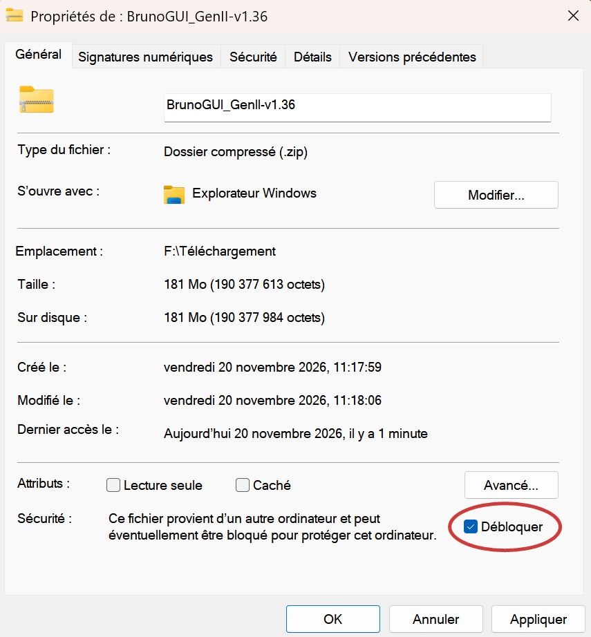

### Installation (archive portable)

1. Téléchargez `BrunoGUI_GenII.zip` (ci-dessous).
2. **Avant de décompresser** : clic droit sur le zip > **Propriétés** > cochez **« Débloquer »** > **OK**.
3. Décompressez, puis lancez `BrunoGUI_GenII.exe`.

Si Windows affiche « Windows a protégé votre ordinateur » (SmartScreen), cliquez sur « Informations complémentaires » si besoin, puis sur **« Exécuter quand même »**. Cet avertissement vient de ce que le programme, libre et gratuit, n'est pas signé numériquement : il ne signale pas un problème du programme.

Rien d'autre à installer : .NET est inclus dans l'archive.

L'aide du programme est aussi disponible en PDF, ci-dessous : `BrunoGUI_Aide_fr.pdf`.

---

### Installation (portable archive)

1. Download `BrunoGUI_GenII.zip` (below).
2. **Before extracting**: right-click the zip > **Properties** > tick **“Unblock”** > **OK**.
3. Extract it, then run `BrunoGUI_GenII.exe`.

If Windows shows “Windows protected your PC” (SmartScreen), click “More info” if needed, then **“Run anyway”**. This warning comes from the program, which is free, not being digitally signed: it does not indicate a problem with the program.

Nothing else to install: .NET is included in the archive.

The program's help is also available as a PDF, below: `BrunoGUI_Aide_en.pdf`.
